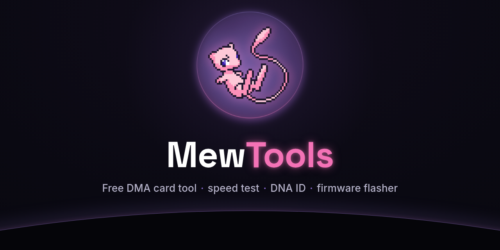
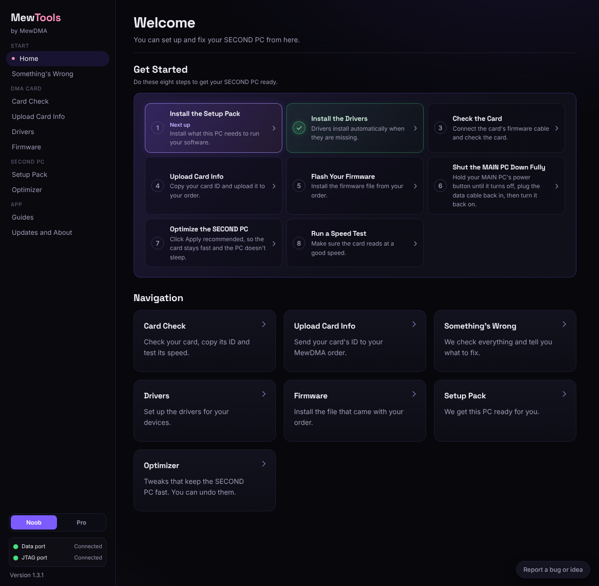
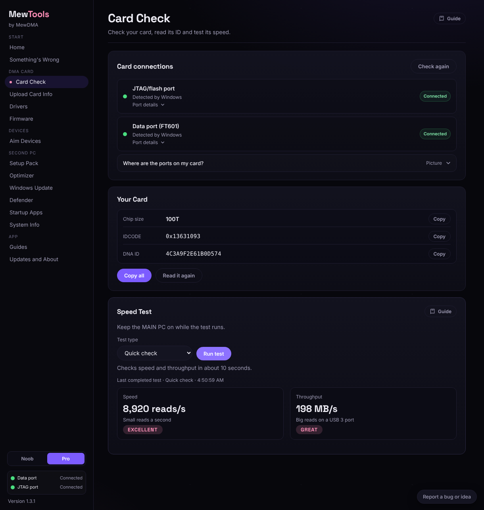
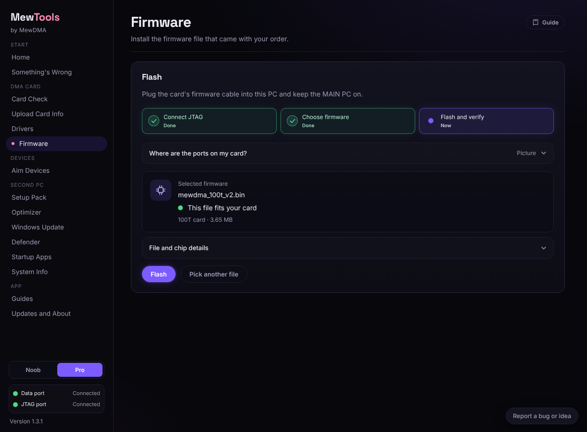
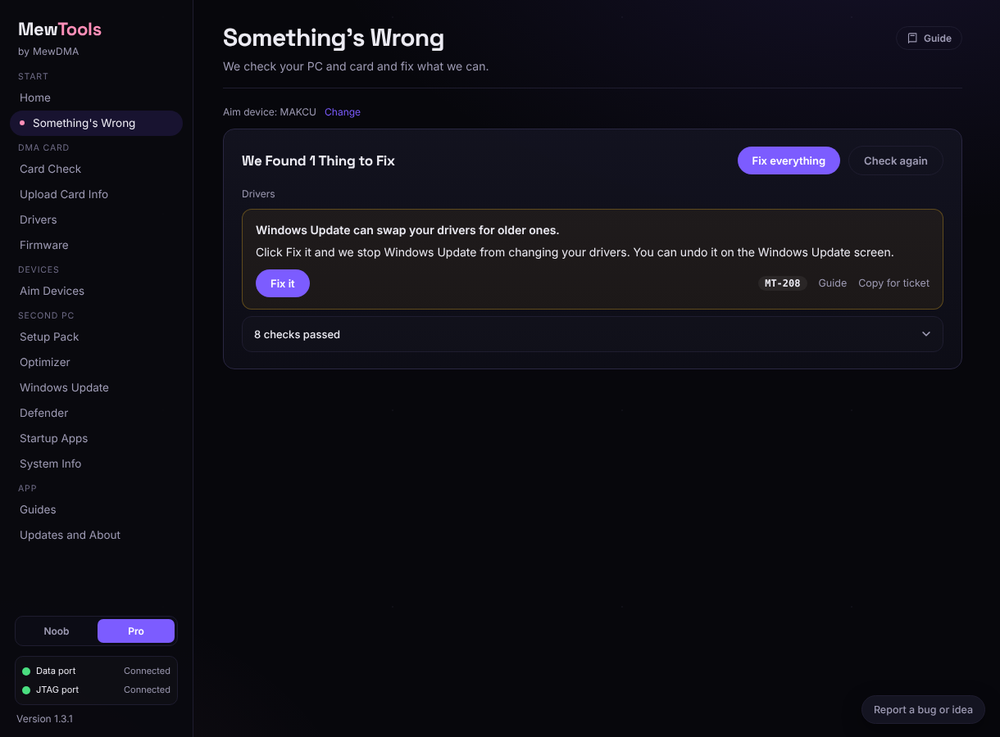

# MewTools, the free DMA card app for your second PC

MewTools is a free Windows app made by [MewDMA](https://mewdma.net) for people who use a DMA card with a second PC. You install it on the SECOND PC, and it checks your card, reads the DNA ID, runs a speed test, installs the drivers, flashes your firmware and tests MAKCU, FERRUM and KMBox aim devices. It works with any 75T or 100T FPGA DMA card and you can [download the latest version here](https://github.com/MewDMA/MewTools/releases/latest).

<b>Windows 10 and 11, 64 bit</b> &nbsp;·&nbsp; <b>12 languages</b> &nbsp;·&nbsp; <b>Updates itself</b>

<a href="#mewtools-features">Features</a> &nbsp;|&nbsp;
<a href="#mewtools-screenshots">Screenshots</a> &nbsp;|&nbsp;
<a href="#supported-dma-cards-and-hardware">Hardware</a> &nbsp;|&nbsp;
<a href="#mewtools-faq">FAQ</a> &nbsp;|&nbsp;
<a href="#guides-and-support">Guides</a>

## Download and install MewTools

1. Grab `MewTools-Setup-<version>.exe` from the [latest release](https://github.com/MewDMA/MewTools/releases/latest). It's a normal Windows installer, and the release also has a `SHA256SUMS.txt` if you want to check the file.
2. Run it and follow the installer.
3. Open MewTools. It asks for admin because installing drivers, flashing and changing Windows settings all need it.

> [!IMPORTANT]
> MewTools only goes on the SECOND PC, the one your card's USB cables plug into, so you don't put it on the MAIN PC.

> [!NOTE]
> If Windows says "Windows protected your PC", click **More info** and then **Run anyway**. That shows up because the installer isn't code signed yet.

## MewTools features

<table>
<tr>
<td width="50%" valign="top">

### 🔍 Check your DMA card and DNA ID

Card Check reads the chip size, IDCODE and DNA ID, and the speed test rates your card.

</td>
<td width="50%" valign="top">

### ⚡ Flash your DMA firmware

Flashes `.bin` and `.bit` firmware over JTAG, then reads the card back to make sure it matches the file.

</td>
</tr>
<tr>
<td width="50%" valign="top">

### 🔌 Install DMA card drivers

FTDI, WCH and Silicon Labs drivers for your card and aim device, each checked before it runs.

</td>
<td width="50%" valign="top">

### 🛠️ Fix DMA card problems

Something's Wrong checks your setup and fixes what it can, and every error has a short code with its fix.

</td>
</tr>
<tr>
<td width="50%" valign="top">

### 🎯 Test MAKCU, FERRUM and KMBox

Move, click and mouse input tests for your aim device, and MAKCU boards on Medius firmware work too.

</td>
<td width="50%" valign="top">

### 📤 Send your card info to MewDMA

Link your mewdma.net account and MewTools sends your card info to your order for you.

</td>
</tr>
<tr>
<td width="50%" valign="top">

### 🖥️ Set up the SECOND PC

Setup Pack installs missing runtimes from Microsoft, and the Optimizer has safe tweaks you can undo any time.

</td>
<td width="50%" valign="top">

### 🎛️ Noob and Pro mode

Noob mode keeps it simple and runs fixes by itself. Pro mode shows every screen, more speed test options and the full error details.

</td>
</tr>
<tr>
<td colspan="2" valign="top">

### 🛟 Remote Support from MewDMA

Off until you turn it on. When you click Allow on the PC, MewDMA support can use the whole PC to fix things for you, with a banner and a Disconnect button on screen the whole time and a session log you can read.

</td>
</tr>
</table>

<b>See every MewTools feature in detail</b>

#### Check your DMA card

| Part | What it does |
|---|---|
| Card Check | Finds your card and reads the chip size, IDCODE and DNA ID over the JTAG cable, each with its own Copy button. |
| Cables | Shows if the card's data cable and firmware (JTAG) cable are connected, and if their drivers work. |
| Speed test | Runs the same reads and test lengths as Lone's DMA Test Tool, on the same LeechCore, vmm and FTD3XX files, and rates your card Slow, Good, Fast or Excellent. |
| Pro mode | Adds Speed only, Throughput only and a Stability run with the min, average and max. |

#### Flash your DMA firmware

MewTools flashes `.bin` and `.bit` firmware over JTAG with a WCH CH347 or FTDI cable, using OpenOCD.

| Step | What happens |
|---|---|
| Before | It checks the file is real Xilinx firmware made for your card's chip and shows the file's name and SHA-256. |
| After | The flash only counts as done once the card's memory is read back and matches the file. Then it walks you through turning the MAIN PC off and on again. |
| From your order | Link your mewdma.net account and you can install the firmware from your MewDMA order directly, checked against that order. |

#### Install DMA card and aim device drivers

MewTools installs the FTDI FT601 (D3XX), WCH CH347, WCH CH343 and Silicon Labs CP210x drivers from the vendors' own sites, and checks each one is signed before it runs.

| Part | What it does |
|---|---|
| Noob mode | Missing or old drivers install by themselves, also when you plug a device in later. |
| Status | Each driver shows if it's working, installed with the device unplugged, or missing. |
| Fix it | If Zadig or another tool put its own driver on the card's data port, Fix it puts FTDI's driver back. |
| Backup copies | If a vendor site is down, MewTools uses our backup copies from the [assets-v1 release](https://github.com/MewDMA/MewTools/releases/tag/assets-v1) in this repo, and each one has to match a SHA-256 that's built into the app. |

#### Fix DMA card problems

Something's Wrong checks your card, cables, drivers, aim device and PC, fixes what it can by itself and tells you what's left to do.

| Part | What it does |
|---|---|
| Error codes | Every error has a short code like MT-116 with the cause and the fix, and each code links to its own fix on [mewdma.net/guides](https://mewdma.net/guides). |
| Copy for ticket | Copies the details in English, so you can paste them in a ticket in our Discord. |

#### Upload your card info to a MewDMA order

Link your mewdma.net account, pick your order and MewTools sends your DNA ID, chip size, IDCODE and card model to it.

| Part | What it does |
|---|---|
| Status | Shows what was sent and what is still missing, like the msinfo32 file from your MAIN PC. |
| Your link | The link is kept in Windows Credential Manager and you can unlink it any time. |
| Optional | This part is optional and only for MewDMA orders. |

#### Test aim devices (MAKCU, FERRUM, KMBox)

The Aim Devices screen finds MAKCU, FERRUM and KMBox B or KMBox compatible devices on their COM ports.

| Part | What it does |
|---|---|
| Tests | Runs a move test, a click test and a mouse input test, and you confirm on the MAIN PC what happened. |
| Medius | MAKCU boards running Medius firmware work too. MewTools shows the Medius version and tests the box with Medius commands. |
| COM ports | COM10 and higher work, and you can change the COM number if you want to. |
| Updates | For MAKCU updates it points you to MAKCU's official Toolkit, and for a Medius box to the Medius dashboard. |

#### Set up the SECOND PC

These screens get your DMA second PC ready, and MewTools also deletes old temp files by itself each time it opens.

| Screen | What it does |
|---|---|
| Setup Pack | Installs the Visual C++ runtimes, DirectX, .NET and WebView2 if they're missing, from Microsoft. It also finds your graphics card and points you to the right driver app. |
| Optimizer | Safe tweaks for a DMA second PC and an Apply recommended button. It makes a restore point first and you can undo every tweak. |
| Windows Update | Pause updates, only get security updates, stop Windows from changing your drivers, stop background apps or turn updates off. Use Windows defaults puts it all back. |
| Defender | Turn it off, and turn it back on whenever you want. If Tamper Protection is on, MewTools shows you how to turn it off first. |
| Startup Apps | Search your startup apps and turn them off one at a time or all at once. |
| System Info | Shows this PC, your monitors, USB and network, and you can copy it or save it to a file. |

#### Remote Support

Remote Support lets MewDMA support, which is Mew, our AI support bot, and MewDMA staff in your ticket, fix things on your SECOND PC while you're in a ticket in our Discord.

| Part | What it does |
|---|---|
| Off by default | Nothing connects until you turn it on in MewTools > Remote Support, and it switches itself off after 2 hours without a request. |
| Your OK | Every session needs one Allow on the PC, and the request is denied if you don't answer in 2 minutes. |
| Full access | After Allow, support can use the whole PC, including commands, files, the registry, the screen, mouse and keyboard, drivers, restarts and every MewTools feature, including flashing. |
| Protected data | Browser profiles, saved passwords, chat apps, wallets, password managers, game logins and other private data stay off limits. |
| Banner | A "Mew is connected" banner stays on top with a Disconnect button that ends the whole session. |
| Limits | A session ends after 30 minutes with nothing happening or 3 hours in total. |
| Session log | Every session and command is written to a log on the PC that you can read, save or clear. |
| Your account | Linking your mewdma.net account lets support confirm the PC is yours. |

#### Languages, updates and Get Started

| Part | What it does |
|---|---|
| Languages | 12 languages. It opens in your Windows language when it's one of them. |
| Updates | Automatic updates that are signed by us and checked before they install. |
| Get Started | A checklist on Home that ticks off each step of your setup. |

## MewTools screenshots

<table>
<tr>
<td width="50%" valign="top" align="center">Home with Get Started </td>
<td width="50%" valign="top" align="center">Card Check and speed test </td>
</tr>
<tr>
<td width="50%" valign="top" align="center">Firmware flasher </td>
<td width="50%" valign="top" align="center">Something's Wrong check </td>
</tr>
</table>

## Supported DMA cards and hardware

| Part | What works |
|---|---|
| DMA&nbsp;card | Xilinx Artix-7 FPGA, in 75T and 100T cards |
| Data&nbsp;port | FTDI FT601 (D3XX driver) |
| JTAG&nbsp;cable | WCH CH347T, WCH CH347F, FTDI FT232H, FT2232H and FT4232H, used to read the DNA ID and flash firmware |
| Aim&nbsp;devices | MAKCU (including Medius firmware), FERRUM, KMBox B and KMBox compatible devices |

## MewTools FAQ

<b>Do I need to be a MewDMA customer to use MewTools?</b>

No, MewTools works with any 75T or 100T FPGA DMA card. Linking a mewdma.net account is optional and only adds sending your card info to an order and installing firmware from that order.

<b>Which DMA cards and JTAG cables does MewTools support?</b>

Any Xilinx Artix-7 FPGA DMA card in 75T or 100T size with an FTDI FT601 data port works, and the JTAG cables and aim devices are listed under [Supported DMA cards and hardware](#supported-dma-cards-and-hardware).

<b>How do I find my DMA card's DNA ID?</b>

Plug the card's firmware cable (the JTAG port) into your SECOND PC, keep the MAIN PC on so the card has power, open Card Check in MewTools and click Read card. Your DNA ID shows with a Copy button next to it. Our [DNA ID guide](https://mewdma.net/guides/dna-id-and-msinfo32#h-your-dna-id) has pictures.

<b>How do I flash DMA firmware with MewTools?</b>

Plug the card's firmware cable into the SECOND PC with the MAIN PC on, open Firmware in MewTools and pick your `.bin` or `.bit` file, or the firmware from your MewDMA order. MewTools checks the file fits your card's chip, writes it, reads it back to make sure it matches, then walks you through turning the MAIN PC off and on. Our [flashing guide](https://mewdma.net/guides/flashing-your-firmware) has pictures.

<b>What does the MewTools speed test number mean?</b>

The MewTools speed test shows two numbers, and both need the card on a USB 3 port to get a rating. Speed is how many small 4 KB reads a second your card gets from the MAIN PC's memory, and Throughput is how fast big reads go in MB/s. This is where each rating starts.

| Speed (4 KB reads a second) | Throughput (MB/s) |
|---|---|
| **Slow** under 3,800 | **Slow** under 80 |
| **Good** from 3,800 | **OK** from 80 |
| **Fast** from 4,800 | **Good** from 140 |
| **Excellent** at 6,000 or more | **Great** at 185 or more |

<b>Why can't my DMA card read the MAIN PC?</b>

When MewTools says your card can't read the MAIN PC (error MT-116), most of the time the card needs a full power cycle or the firmware isn't activated since the MAIN PC last started. Try these in order:

1. Shut the MAIN PC fully down, switch its power off for 30 seconds and turn it back on.
2. Run your firmware's activator if it uses one. You need to do this again every time the MAIN PC restarts.
3. Make sure the data cable is in a blue or red USB 3 port on the back of the SECOND PC.
4. Open Something's Wrong in MewTools and let it check everything.

> [!TIP]
> If it still can't read, click Copy for ticket and open a ticket in our [Discord](https://discord.gg/mewdma).

<b>Does MewTools install anything on the MAIN PC?</b>

No, MewTools only runs on the SECOND PC, the one your card's USB cables plug into. You don't put MewTools on the MAIN PC.

<b>Is MewTools safe, and what does it change?</b>

MewTools runs as admin because drivers, flashing and Windows settings need it. It only downloads from the official vendor sites and checks every file's signature or SHA-256 before running it, and the Optimizer makes a restore point and saves the old value of every tweak so you can undo it. When it shows an error, it sends that error to MewDMA with a PC ID so we can fix it faster. Remote Support is off until you turn it on, and it only lets support use the PC after you click Allow, as explained in [Remote Support](docs/security.md#remote-support). All of this is explained in [docs/security.md](docs/security.md).

<b>What can MewDMA support do with Remote Support?</b>

Remote Support is off until you turn it on. When support asks to connect, MewTools shows one window on the PC, and nothing happens unless you click Allow. After that, support can use the whole PC until the session ends: run commands, see your screen, use the mouse and keyboard, move files, change the registry, install drivers, restart the PC and use every MewTools feature, including flashing your card. Browser profiles, saved passwords, chat apps, wallets, password managers and game logins stay off limits.

A banner stays on top the whole time, and Disconnect ends the session right away. Sessions end after 30 minutes with nothing happening or 3 hours in total, and every session and command goes in a log you can read in MewTools. All the details, and how to turn it off for good, are in [docs/security.md](docs/security.md#remote-support).

<b>Which languages does MewTools support?</b>

MewTools speaks English, Spanish (Español), Portuguese (Português), French (Français), German (Deutsch), Italian (Italiano), Dutch (Nederlands), Polish (Polski), Turkish (Türkçe), Russian (Русский), Japanese (日本語) and Chinese (中文). It opens in your Windows language when it's one of these, and you can change it in Updates and About. Copy for ticket always stays in English so our support can read it.

<b>How do MewTools updates work?</b>

MewTools checks the MewDMA/MewTools GitHub releases for a newer version when it opens and once a day, and every update is signed by us and checked before it installs. Automatic updates is on by default, so a new version installs and the app restarts by itself. If you turn it off in Updates and About, you get a bar with an Install and restart button instead.

<b>What's the difference between Noob and Pro mode in MewTools?</b>

MewTools has two modes. Noob mode is the default and shows fewer screens, short errors and fixes that run by themselves. Pro mode adds Aim Devices, Windows Update, Defender, Startup Apps and System Info, more speed test options and the full error details.

<b>Why does Windows say "Windows protected your PC" when I install MewTools?</b>

Windows SmartScreen shows that message because the MewTools installer isn't code signed yet. Click More info and then Run anyway to install it.

## Guides and support

> [!TIP]
> If you get stuck, click Copy for ticket in MewTools and open a ticket in our [Discord](https://discord.gg/mewdma), then paste the details in.

All our guides are at [mewdma.net/guides](https://mewdma.net/guides) and short versions are on our [GitBook](https://mewdma-1.gitbook.io/dma-guides/). Each error code in the app links to its own fix there, and what changed in each version is in [CHANGELOG.md](CHANGELOG.md).

Step by step guides with pictures:

<!-- mewtools-guides -->
- [Getting your DNA ID and msinfo32](https://mewdma.net/guides/dna-id-and-msinfo32)
- [Installing drivers](https://mewdma.net/guides/installing-drivers-with-mewtools)
- [Flashing firmware](https://mewdma.net/guides/flashing-your-firmware)
- [Flashing MAKCU](https://mewdma.net/guides/updating-makcu-to-v4)
- [Setting up a fresh second PC](https://mewdma.net/guides/second-pc-setup#h-fresh-windows-setup-pack-and-optimizer)
- [Speed test ratings](https://mewdma.net/guides/healthy-dma-speed-test)
- [Fixing a COM port 10 or higher](https://mewdma.net/guides/fix-com-port-10-or-higher)
- [Sending a Something's wrong report](https://mewdma.net/guides/send-a-mewtools-report)
- [Using the Windows Update and Defender pages safely](https://mewdma.net/guides/mewtools-windows-update-and-defender)

How MewTools handles security: [docs/security.md](docs/security.md).
