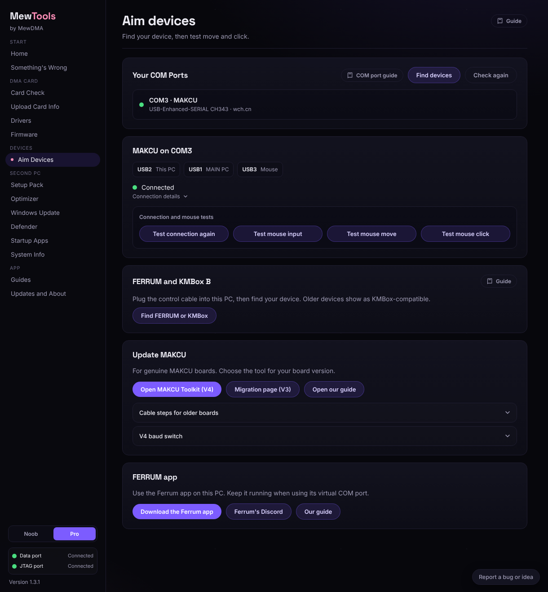
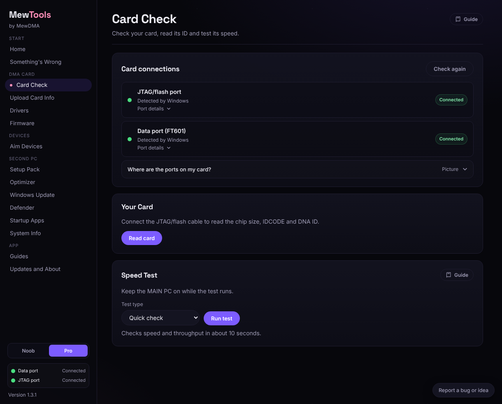
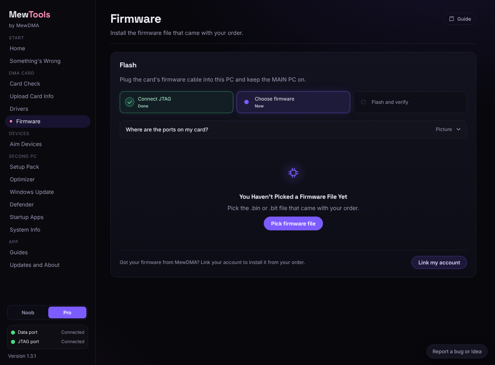
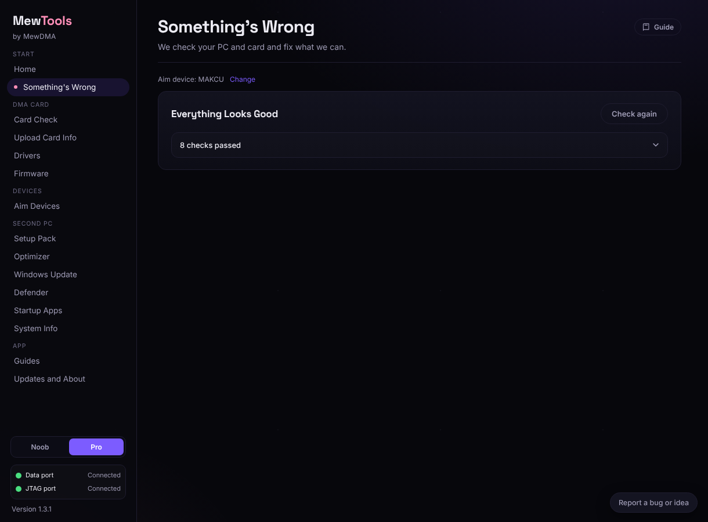

# MewTools

MewTools is a free Windows app made by [MewDMA](https://mewdma.net) for people who use a DMA card with a second PC. You install it on the SECOND PC (Windows 10 or 11, 64 bit), and it checks your card, reads the DNA ID, runs a speed test, installs the drivers, flashes your firmware and tests MAKCU, FERRUM and KMBox aim devices. It works with any 75T or 100T FPGA DMA card and you can [download the latest version here](https://github.com/MewDMA/MewTools/releases/latest).

<b>Free</b> &nbsp;·&nbsp; Windows 10 and 11, 64 bit &nbsp;·&nbsp; 75T and 100T DMA cards &nbsp;·&nbsp; 12 languages &nbsp;·&nbsp; Noob and Pro mode

<a href="#download-and-install-mewtools">Download</a> &nbsp;|&nbsp;
<a href="#mewtools-screenshots">Screenshots</a> &nbsp;|&nbsp;
<a href="#mewtools-features">Features</a> &nbsp;|&nbsp;
<a href="#supported-dma-cards-and-hardware">Supported hardware</a> &nbsp;|&nbsp;
<a href="#mewtools-faq">FAQ</a> &nbsp;|&nbsp;
<a href="#guides-and-support">Guides and support</a>

## Download and install MewTools

1. Grab `MewTools-Setup-<version>.exe` from the [latest release](https://github.com/MewDMA/MewTools/releases/latest). It's a normal Windows installer, and the release also has a `SHA256SUMS.txt` if you want to check the file.
2. Run it on your SECOND PC. If Windows says "Windows protected your PC", click **More info** and then **Run anyway**. That shows up because the installer isn't code signed yet.
3. Open MewTools. It asks for admin because installing drivers, flashing and changing Windows settings all need it.

> [!IMPORTANT]
> MewTools only goes on the SECOND PC, so you don't put it on the MAIN PC. After the first install, MewTools updates itself.

## MewTools screenshots

<table>
<tr>
<td width="33%" valign="top" align="center">Home with the Get Started checklist </td>
<td width="33%" valign="top" align="center">Speed test and its rating </td>
<td width="33%" valign="top" align="center">Aim Devices for MAKCU, FERRUM and KMBox </td>
</tr>
<tr>
<td width="33%" valign="top" align="center">Card Check with chip size, IDCODE and DNA ID </td>
<td width="33%" valign="top" align="center">Firmware flasher </td>
<td width="33%" valign="top" align="center">Something's Wrong check </td>
</tr>
</table>

## MewTools features

### Check your DMA card

- Card Check finds your card and reads the chip size, IDCODE and DNA ID over the JTAG cable, each with its own Copy button.
- It shows if the card's data cable and firmware (JTAG) cable are connected, and if their drivers work.
- The speed test runs the same reads and test lengths as Lone's DMA Test Tool, on the same LeechCore, vmm and FTD3XX files, and rates your card Slow, Good, Fast or Excellent.
- Pro mode adds Speed only, Throughput only and a Stability run with the min, average and max.

### Flash your DMA firmware

- Flashes `.bin` and `.bit` firmware over JTAG with a WCH CH347 or FTDI cable, using OpenOCD.
- Before it writes anything, it checks the file is real Xilinx firmware made for your card's chip and shows the file's name and SHA-256.
- The flash only counts as done once the card's memory is read back and matches the file. Then it walks you through turning the MAIN PC off and on again.
- Link your mewdma.net account and you can install the firmware from your MewDMA order directly, checked against that order.

### Install DMA card and aim device drivers

- Installs the FTDI FT601 (D3XX), WCH CH347, WCH CH343 and Silicon Labs CP210x drivers from the vendors' own sites, and checks each one is signed before it runs.
- In Noob mode, missing or old drivers install by themselves, also when you plug a device in later.
- Each driver shows if it's working, installed with the device unplugged, or missing. If Zadig or another tool put its own driver on the card's data port, Fix it puts FTDI's driver back.
- If a vendor site is down, MewTools uses our backup copies from the [assets-v1 release](https://github.com/MewDMA/MewTools/releases/tag/assets-v1) in this repo, and each one has to match a SHA-256 that's built into the app.

### Fix DMA card problems

- Something's Wrong checks your card, cables, drivers, aim device and PC, fixes what it can by itself and tells you what's left to do.
- Every error has a short code like MT-116 with the cause and the fix, and each code links to its own fix on [mewdma.net/guides](https://mewdma.net/guides).
- Copy for ticket copies the details in English, so you can paste them in a ticket in our Discord.

### Upload your card info to a MewDMA order

- Link your mewdma.net account, pick your order and MewTools sends your DNA ID, chip size, IDCODE and card model to it.
- It shows what was sent and what is still missing, like the msinfo32 file from your MAIN PC.
- The link is kept in Windows Credential Manager and you can unlink it any time. This part is optional and only for MewDMA orders.

### Test aim devices (MAKCU, FERRUM, KMBox)

- The Aim Devices screen finds MAKCU, FERRUM and KMBox B or KMBox compatible devices on their COM ports.
- It runs a move test, a click test and a mouse input test, and you confirm on the MAIN PC what happened.
- MAKCU boards running Medius firmware work too. MewTools shows the Medius version and tests the box with Medius commands.
- COM10 and higher work, and you can change the COM number if you want to.
- For MAKCU updates it points you to MAKCU's official Toolkit, and for a Medius box to the Medius dashboard.

### Set up the SECOND PC

- Setup Pack installs the Visual C++ runtimes, DirectX, .NET and WebView2 if they're missing, from Microsoft. It also finds your graphics card and points you to the right driver app.
- The Optimizer has safe tweaks for a DMA second PC and an Apply recommended button. It makes a restore point first and you can undo every tweak.
- MewTools deletes old temp files by itself each time it opens.
- Windows Update lets you pause updates, only get security updates, stop Windows from changing your drivers, stop background apps or turn updates off, and Use Windows defaults puts it all back.
- Defender can be turned off, and turned back on whenever you want. If Tamper Protection is on, MewTools shows you how to turn it off first.
- Startup Apps lets you search your startup apps and turn them off one at a time or all at once.
- System Info shows this PC, your monitors, USB and network, and you can copy it or save it to a file.

### Languages, modes and updates

- 12 languages. It opens in your Windows language when it's one of them.
- Noob mode is the default, with fewer screens, short errors and more fixes that run by themselves. Pro mode shows every screen and the full error details.
- Automatic updates that are signed by us and checked before they install.
- A Get Started checklist on Home that ticks off each step of your setup.

## Supported DMA cards and hardware

| Part | What works |
|---|---|
| DMA card chip | Xilinx Artix-7 FPGA, in 75T and 100T cards |
| Data port | FTDI FT601 (D3XX driver) |
| JTAG cable | WCH CH347T, WCH CH347F, FTDI FT232H, FT2232H and FT4232H |
| Aim devices | MAKCU (including Medius firmware), FERRUM, KMBox B and KMBox compatible devices |
| Windows | Windows 10 and 11, 64 bit |

## MewTools languages

English, Español, Português, Français, Deutsch, Italiano, Nederlands, Polski, Türkçe, Русский, 日本語 and 中文. Copy for ticket always stays in English so our support can read it.

## MewTools FAQ

### What is MewTools?

MewTools is a free Windows app from MewDMA for setting up and fixing a DMA card on your second PC. It checks the card, reads the DNA ID, runs a speed test, installs drivers, flashes firmware and tests aim devices like MAKCU and FERRUM.

### Is MewTools free?

Yes, MewTools is free to download and use. You get it from the [MewDMA/MewTools releases page](https://github.com/MewDMA/MewTools/releases/latest) on GitHub.

### Do I need to be a MewDMA customer to use MewTools?

No, MewTools works with any 75T or 100T FPGA DMA card. Linking a mewdma.net account is optional and only adds sending your card info to an order and installing firmware from that order.

### Which DMA cards and JTAG cables does MewTools support?

MewTools works with Xilinx Artix-7 FPGA DMA cards in 75T and 100T sizes that use an FTDI FT601 data port. To read the DNA ID or flash firmware, the card's JTAG port needs a WCH CH347T or CH347F chip, or an FTDI FT232H, FT2232H or FT4232H chip.

### How do I find my DMA card's DNA ID?

Plug the card's firmware cable (the JTAG port) into your SECOND PC, keep the MAIN PC on so the card has power, open Card Check in MewTools and click Read card. Your DNA ID shows with a Copy button next to it. Our [DNA ID guide](https://mewdma.net/guides/dna-id-and-msinfo32#h-your-dna-id) has pictures.

### How do I flash DMA firmware with MewTools?

Plug the card's firmware cable into the SECOND PC with the MAIN PC on, open Firmware in MewTools and pick your `.bin` or `.bit` file, or the firmware from your MewDMA order. MewTools checks the file fits your card's chip, writes it, reads it back to make sure it matches, then walks you through turning the MAIN PC off and on. Our [flashing guide](https://mewdma.net/guides/flashing-your-firmware) has pictures.

### What does the MewTools speed test number mean?

The MewTools speed test shows two numbers, and both need the card on a USB 3 port to get a rating. Speed is how many small 4 KB reads a second your card gets from the MAIN PC's memory: under 3,800 is Slow, from 3,800 is Good, from 4,800 is Fast and 6,000 or more is Excellent. Throughput is big reads in MB/s: under 80 is Slow, from 80 is OK, from 140 is Good and 185 or more is Great.

### Why can't my DMA card read the MAIN PC?

When MewTools says your card can't read the MAIN PC (error MT-116), most of the time the card needs a full power cycle or the firmware isn't activated since the MAIN PC last started. Try these in order:

1. Shut the MAIN PC fully down, switch its power off for 30 seconds and turn it back on.
2. Run your firmware's activator if it uses one. You need to do this again every time the MAIN PC restarts.
3. Make sure the data cable is in a blue or red USB 3 port on the back of the SECOND PC.
4. Open Something's Wrong in MewTools and let it check everything.

If it still can't read, click Copy for ticket and open a ticket in our [Discord](https://discord.gg/mewdma).

### Does MewTools install anything on the MAIN PC?

No, MewTools only runs on the SECOND PC, the one your card's USB cables plug into. You don't put MewTools on the MAIN PC.

### Is MewTools safe, and what does it change?

MewTools runs as admin because drivers, flashing and Windows settings need it. It only downloads from the official vendor sites and checks every file's signature or SHA-256 before running it, and the Optimizer makes a restore point and saves the old value of every tweak so you can undo it. When it shows an error, it sends that error to MewDMA with a PC ID so we can fix it faster, and all of this is explained in [docs/security.md](docs/security.md).

### Which languages does MewTools support?

MewTools speaks English, Spanish, Portuguese, French, German, Italian, Dutch, Polish, Turkish, Russian, Japanese and Chinese. It opens in your Windows language when it's one of these, and you can change it in Updates and About.

### How do MewTools updates work?

MewTools checks the MewDMA/MewTools GitHub releases for a newer version when it opens and once a day, and every update is signed by us and checked before it installs. Automatic updates is on by default, so a new version installs and the app restarts by itself. If you turn it off in Updates and About, you get a bar with an Install and restart button instead.

### What's the difference between Noob and Pro mode in MewTools?

MewTools has two modes. Noob mode is the default and shows fewer screens, short errors and fixes that run by themselves. Pro mode adds Aim Devices, Windows Update, Defender, Startup Apps and System Info, more speed test options and the full error details.

### Why does Windows say "Windows protected your PC" when I install MewTools?

Windows SmartScreen shows that message because the MewTools installer isn't code signed yet. Click More info and then Run anyway to install it.

## Guides and support

- All our step by step guides are at [mewdma.net/guides](https://mewdma.net/guides), and short versions are on our [GitBook](https://mewdma-1.gitbook.io/dma-guides/).
- Each error code in the app links to its own fix on mewdma.net/guides.
- If you get stuck, open a ticket in our [Discord](https://discord.gg/mewdma).
- What changed in each version is in [CHANGELOG.md](CHANGELOG.md).

## About MewTools

MewTools is made by [MewDMA](https://mewdma.net). It's free, and you can grab the newest version from the [latest release](https://github.com/MewDMA/MewTools/releases/latest) any time.

<!-- mewtools-guides -->
## Guides

Our step by step guides with pictures are on mewdma.net:

- [Getting your DNA ID](https://mewdma.net/guides/dna-id-and-msinfo32#h-your-dna-id)
- [DNA ID and msinfo32](https://mewdma.net/guides/dna-id-and-msinfo32)
- [Installing drivers](https://mewdma.net/guides/installing-drivers-with-mewtools)
- [Flashing firmware](https://mewdma.net/guides/flashing-your-firmware)
- [Flashing MAKCU](https://mewdma.net/guides/updating-makcu-to-v4)
- [Setting up a fresh second PC](https://mewdma.net/guides/second-pc-setup#h-fresh-windows-setup-pack-and-optimizer)
- [Speed test ratings](https://mewdma.net/guides/healthy-dma-speed-test)
- [Fixing a COM port 10 or higher](https://mewdma.net/guides/fix-com-port-10-or-higher)
- [Sending a Something's wrong report](https://mewdma.net/guides/send-a-mewtools-report)
- [Using the Windows Update and Defender pages safely](https://mewdma.net/guides/mewtools-windows-update-and-defender)

How MewTools handles security: [docs/security.md](docs/security.md).
